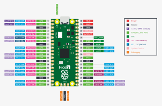
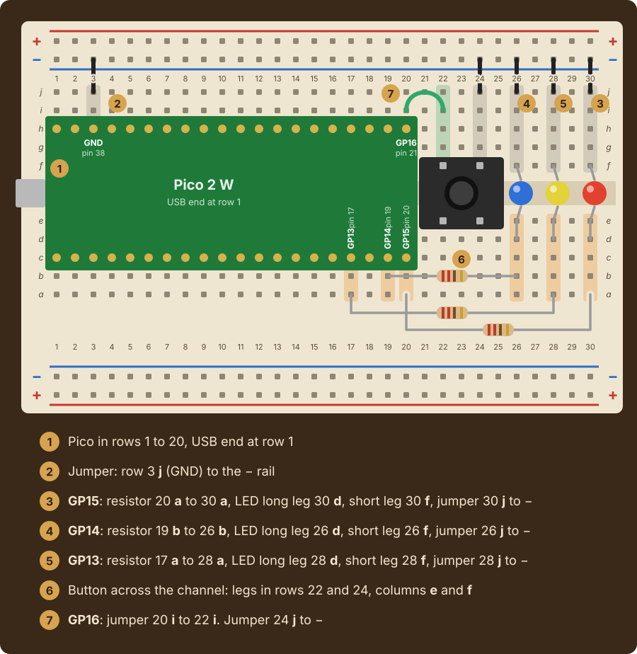
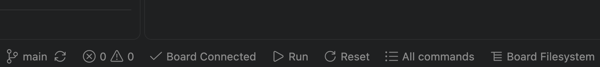

# Lab 6: Morse Code

|Item |       |
|:----|:------|
|Released |Friday, October 30, at the lab session |
|Due |Friday, November 6, 2:30pm |
|Progress |[](../../actions/workflows/main.yml) |

In 1844 Samuel Morse sent the first message over a long-distance telegraph line. A telegraph
carried only two signals, current on and current off, so Morse and his partner Alfred Vail
invented a code that spells every letter with short and long signals, called dots and dashes.
An operator pressed a key to send them and listened to a sounder on the other end.

In this lab, your push button is the telegraph key and the built-in LED is the sounder. You
read a code book from a file into a dictionary, and use it in both directions: to turn a
message into dots and dashes, and to turn the dots and dashes you key back into letters. A short press is
a dot, a long press is a dash, and a pause of one second ends a letter.

## Contents

* [Course learning outcomes](#course-learning-outcomes)
* [The circuit](#the-circuit)
* [The stages](#the-stages)
  * [The functions](#the-functions)
  * [The operator log](#the-operator-log)
  * [Expected output](#expected-output)
* [Getting started](#getting-started)
  * [Testing on your Pico](#testing-on-your-pico)
* [Evaluation](#evaluation)
  * [Programming, 3.0 points](#programming-30-points)
  * [Code quality and style, 1.0 point](#code-quality-and-style-10-point)
  * [Summary writing, 0.5 points](#summary-writing-05-points)
* [Code review](#code-review)
* [Submitting](#submitting)

## Course learning outcomes

This lab addresses the following course learning outcomes:

**CLO 1.** Apply Python programming fundamentals to execute and explain computer code that
implements interactive, novel solutions to a variety of computable problems.

**CLO 2.** Implement code consistent with industry-standard practices using professional-grade
integrated development environments (IDEs), command-line tools, and version control systems.

Specifically, by the end of this lab you should be able to:

* read a CSV file into a dictionary, add an entry by assigning to a new key, and look a value up by its key
* test whether a key is in a dictionary with `in` before a lookup that could fail
* build one dictionary from another with a `for` loop over its keys
* define functions with parameters that return a value, and call them from other functions
* time a button press with a `while` loop and a counter
* update a counter or a string with `+=`, and count down with `range(start, stop, step)`

## The circuit

You need the button from Lab 5, on GP16, wired the same way. This lab does not use the three
lights; the sounder is the LED built into the Pico, `Pin("LED", Pin.OUT)`. Unplug the USB cable
before you touch the wiring.



The button in the Lab 5 circuit:



If the program reads the button as pressed when nothing touches it, turn the button a quarter
turn. If the button will not work, ask an instructor or TL. Do not troubleshoot hardware alone
the night before it is due.

## The stages

Everything this lab asks for is covered by the Week 10 Session 2 and Session 3 slides and the
weeks before them.

**The story is yours to change.** Every message the program prints is your wording. Two things
stay fixed, because the automated checks depend on them: the functions in the table below keep
their names and parameters, and the operator log at the end keeps its labels.

**The code book.** The file `morse.csv` is provided in the top folder of this repository: a
header line, then one line for each letter and digit with the character, a comma and its pattern
of dots and dashes, such as `S,...`. `read_code_book` reads it into a dictionary, and `CODE` holds
that dictionary. Each key is a character and each value is its pattern. You add two signals that
are not letters: `"AR"`, which is `.-.-.`, and `"SK"`, which is `...-.-`. Then you
build `LETTERS`, the same book read backwards: each pattern is a key and its value is the
character. A `for` loop over the keys of `CODE` builds it, and it has to come after the two
signals are added, so that they are flipped as well.

**Looking up.** `to_morse` turns text into patterns. `from_morse` turns a pattern into a
character, and gives `?` for a pattern that is not in the book.

**The key.** `press_length` times one press. `to_symbol` decides whether that press is a dot or
a dash. `read_letter` keys symbols until a second passes without a press, and returns the
pattern of one letter.

**The operator.** `main` counts down from 3 with `range(3, 0, -1)`, blinking the sounder once
a second, so the operator knows when to start. Then it reads letters one at a time until the
operator keys `SK`, which is the signal for the end of the transmission, and ends with the
operator log.

### The functions

Write these above `main`, and the code book steps above them. The names and parameters must
match exactly, because the automated checks call each one directly.

|Function |What it does |
|:--------|:------------|
|`read_code_book(filename)` |Returns a dictionary from each character in the CSV file to its pattern. It skips the header line, splits each line at the comma, and strips the newline from the line first, so that a pattern is `".-"` and not `".-\n"` |
|`to_morse(text)` |Returns the patterns for the characters of `text`, in upper or lower case, separated by single spaces, adding each pattern to the result with `+=`. A character that is not in `CODE`, such as a space, is skipped. `to_morse("sos")` returns `"... --- ..."` |
|`from_morse(pattern)` |Returns the character for `pattern`, or `"?"` when `pattern` is not a key of `LETTERS` |
|`press_length(button, led)` |Returns how many tenths of a second the button stays down. While `button.value()` is `0`, the LED is on, the function calls `sleep(0.1)`, and `length` goes up by 1. When the button is released the LED goes off |
|`to_symbol(length)` |Returns `"."` when `length` is less than `3`, and `"-"` otherwise |
|`read_letter(button, led)` |Waits for the first press. Then it adds a symbol to the pattern for every press, and after each press waits up to ten tenths of a second for the next one. When a full second passes with no press, the letter is over and the function returns its pattern |

A press that ends before 0.3 seconds is a dot. `PULL_UP` makes a press read `0` and a released
button read `1`. Each of the loops that watch the button has to call `sleep`, or time never
passes for the checks, and a loop that never ends fails its check after five seconds.

### The operator log

The program ends with a log, and the automated checks read **only the log**, never the story.
The log has these lines:

```text
OPERATOR LOG: JJ
==================================================
Message: SOS
Letters: 3
Morse: ... --- ...
```

`Message` holds the letters decoded before `SK`, with a `?` for any pattern that is not in the
book. `Letters` is how many characters `Message` holds, and `Morse` is `to_morse(message)`.

Print each line any of the three ways from Week 3: `print("Letters:", count)`,
`print("Letters: " + str(count))`, or `print(f"Letters: {count}")` all pass. The checks forgive
extra spaces and letter case. The checks type the operator's name as the only answer.

### Expected output

One complete run on the board, keying `S O S` and then `SK`:

```text
==================================================
MORSE CODE
==================================================
What is your name? JJ
Key a message, JJ - end it with SK
3
2
1
Key now
... is S
--- is O
... is S
...-.- is SK

==================================================
OPERATOR LOG: JJ
==================================================
Message: SOS
Letters: 3
Morse: ... --- ...
```

## Getting started

Open `src/main.py` and work through the `TODO` markers in order. The first nine steps are
functions and dictionaries that do not need the board, so check each one as you finish it:

```text
uv run gatorgrade --config gatorgrade.yml
```

> [!IMPORTANT]
> Run every command in this README from the assignment's **working directory**, the top-level
> folder you land in right after cloning, not from inside `src`.

`uv run python src/main.py` does not work for this lab, because a laptop has no button and the
program waits for one. Use the checks for the functions, and run the whole program on the Pico.

### Testing on your Pico

When your program is complete, key a message on your Pico to verify that it works on the
hardware. Plug in the board, open `src/main.py`, and click **Run** in the bar along the bottom
of the window. **Board Connected** must show beside it:



`morse.csv` has to be on the board too, because the program opens it when it starts, and the Run
button sends only the file you have open. Open the folder of this lab itself in VS Code (File,
Open Folder), right-click `morse.csv` in the Explorer, choose MicroPico, then **Upload File to
Board**. It stays on the board, so you do this once.

Press the button briefly for a dot and for a little longer for a dash, and leave a full second
between letters. Key `...-.-` to end.

## Evaluation

This lab is worth **4.5 points**, the standard value for a lab in this course.

| Component | Points | What it measures |
|:----------|:-------|:-----------------|
| Programming | 3.0 | The 11 code checks below. Your score is the fraction passed, times 3.0 |
| Code quality and style | 1.0 | Descriptive names (0.3), clear organization (0.3), useful comments (0.4) |
| Summary writing | 0.5 | A complete, thoughtful `docs/summary.md` |
| **Total** | **4.5** | |

### Programming, 3.0 points

Run the checks yourself, as many times as you like, before you submit:

```text
uv run gatorgrade --config gatorgrade.yml
```

Each check's description says what to look at when it fails. Under a failed check, gatorgrade
also prints a `uv run pytest ...` command. Run it: the last lines say what a function returned
and what was expected. Eleven of the checks are about your code:

* `CODE` gains `AR` and `SK`, and `LETTERS` holds one entry for every entry of `CODE`
* `read_code_book` returns a dictionary from the characters of a CSV file to their patterns
* `to_morse` returns the patterns for a text, skipping characters that are not in the book
* `from_morse` returns the character for a pattern, and `?` for one that is not in the book
* `press_length` returns the length of a press in tenths of a second, with the LED on during it
* `to_symbol` returns a dot or a dash
* `read_letter` returns the pattern of one letter, ends it after a second without a press, and keeps a pause shorter than a second inside the letter
* keying a message and then `SK` logs the decoded message, its length and its patterns
* `read_code_book` uses `with open` and a loop over the lines, `LETTERS` is built by a loop over `CODE`, and `to_morse` checks each character with `in` and builds its result with `+=`
* `press_length`, `read_letter` and `main` have `while` loops, `main` counts down with `range(3, 0, -1)`, and `main` calls the functions
* no `TODO` markers remain, and there are at least six comments

Partial credit is proportional: passing 8 of 11 checks earns `(8 ÷ 11) × 3.0 = 2.2` points.

The remaining two checks look at `docs/summary.md`. They confirm the document is finished, and
they count toward Summary writing below rather than toward these 3.0 points.

> [!NOTE]
> Automated results are preliminary. Your instructor sets the final grade.

### Code quality and style, 1.0 point

Graded by a human reading your code. Descriptive variable names, sensible organization, and
comments that explain **why** rather than restating what the line already says.

### Summary writing, 0.5 points

Complete [`docs/summary.md`](docs/summary.md). Every question answered fully. Minimum word
count is `150`.

## Code review

A Technical Leader or the instructor will conduct a code review with you on this lab. **Code
reviews are graded separately from the 4.5 points above**, under the Code Reviews category on
the syllabus.

Two things happen, with you present:

1. **You key a message** on your board for the reviewer
2. **You answer questions about your own code**, including the concepts behind it

The reviewer opens a **Code Review** issue on your repository and fills it out during the
conversation. The reviewer asks one question about each of four concepts, in their own words
and about your own code, so the questions differ from student to student. Be ready to:

* **Dictionary lookup**: explain what a key and a value are in `CODE`, and why `from_morse`
  checks with `in` before it looks a pattern up
* **Building the books**: explain what `read_code_book` does with each line of `morse.csv`, what
  the loop over `CODE` does on each trip/iteration, and why it comes after `AR` and `SK` are added
* **Timing a press**: explain what `press_length` counts, and why a press under three tenths of
  a second is a dot
* **Ending a letter**: explain what `quiet` counts and what stops the inner `while` loop

**Your review must be completed during the lab session on the day this lab is due.** If you
know in advance that you cannot attend that lab, make arrangements to complete your review
beforehand at office hours. If you submitted this lab on time but missed the code review, you
can make it up at office hours within one week of the due date:

* **Technical Leaders**, listed on the calendar at
  [cis.allegheny.edu/community/news](https://www.cis.allegheny.edu/community/news/)
* **Dr. Jumadinova**, [book a time](https://janyljumadinova.com/office-hours/). Drop-ins are welcome
  during posted hours, but students who booked are seen first

## Submitting

Commit and push often. The last version pushed before the deadline is the one that gets
graded. If you need more time, apply a late token with
[this form](https://forms.gle/3nGbpaNrG96DpLLdA). One token covers both parts of a lab: the
submission and the code review.

**In the terminal:**

```text
git add src/main.py docs/summary.md
git commit -m "Complete the Morse code lab"
git push
```

**In VS Code**, the Source Control panel in the left sidebar does the same three steps:

1. Click **+** next to a changed file to stage it (this is `git add`)
2. Type a message in the box at the top, then click the checkmark (this is `git commit`)
3. Click **Sync Changes** (or the &uarr; arrow) to push

Either way, then open your repository on GitHub and confirm your latest changes are actually
there.
